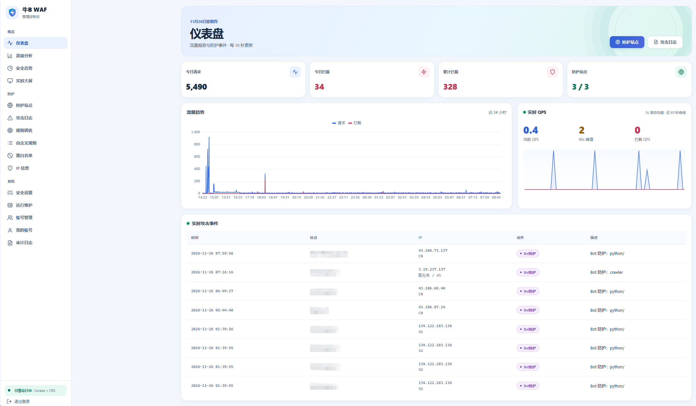
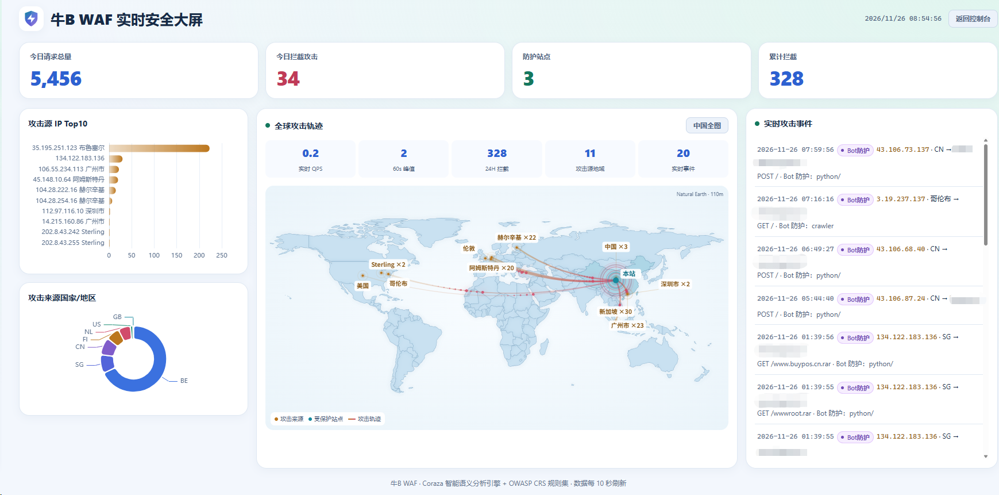
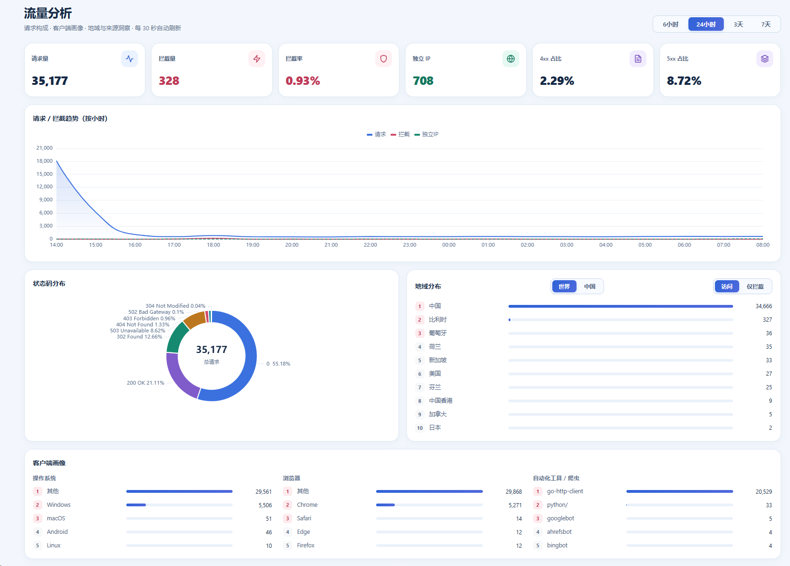
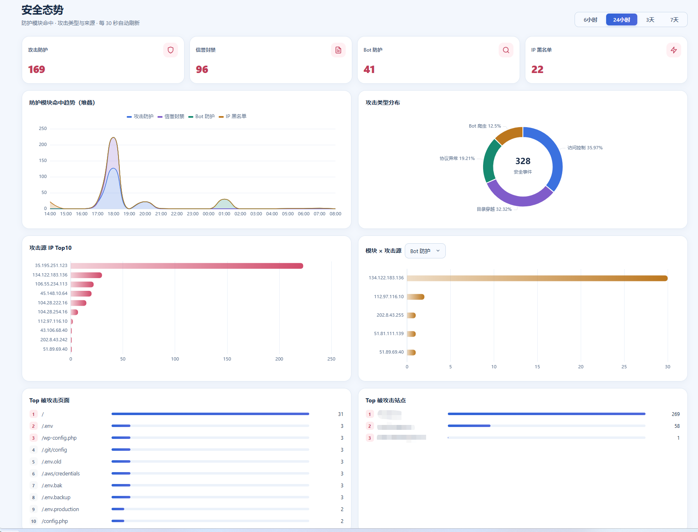

<p align="center">
  <picture>
    <source media="(prefers-color-scheme: dark)" srcset="brand/logo-dark.png">
    
  </picture>
</p>

<p align="center">
  <b>NiuB WAF (NiuBWAF)</b> · 开源自托管 Web 应用防火墙<br>
  Go · Coraza v3 + OWASP CRS4 · 单二进制部署
</p>

<p align="center">
  
  
  
  
</p>

## 简介

NiuB WAF 是一款以反向代理模式部署的**开源自托管 Web 应用防火墙**，用于保护 HTTP/HTTPS 网站和 API。

- **请求检测**：内嵌 OWASP CRS 4.25.2 LTS 和语义分析引擎（SQLi / XSS / RCE / 命令注入 / 扫描器特征）
- **CC 防护**：支持站点默认限额、按路径及方法配置的接口限流，以及 JS 人机验证
- **API 契约**：按站点导入 OpenAPI 3.0 / 3.1，查看接口清单，校验路径、方法、参数和请求体
- **反爬 Bot 防护**：结合 UA、Googlebot/Bingbot 来源验证与短窗口新路径访问行为，可按站点记录、拦截或触发人机验证
- **动态防护**：向页面植入混淆令牌，拦截无令牌的自动化写操作 / 重放 / CSRF
- **IP 治理**：黑白名单、IP 信誉库（攻击自动累积封禁、宽限与赦免）、GeoIP 归属地
- **响应防护**：响应体信息泄露检测（SQL 报错、敏感路径回显等）
- **运营能力**：自定义规则引擎、告警通知、攻击日志检索与流式 CSV 导出、流量分析（客户端画像 / 地域与来源洞察）、安全态势（防护模块命中与攻击类型趋势）、实时安全大屏（全球攻击轨迹地图）、Prometheus `/metrics`
- **控制台权限与审计**：管理员、操作员和只读账号，支持带游标的 NDJSON 审计采集
- **多站点**：SNI 证书路由、多上游负载均衡与健康检查、故障自动切换
- **接入验收与请求诊断**：从实际入口验证 WAF 拦截和正常回源，按请求 ID 查询响应来源、处置结果及有效的请求体上限。[操作步骤](DEPLOY.md#接入验收与请求诊断)
- **工程特性**：纯 Go SQLite（CGO_ENABLED=0）、单一静态二进制、systemd / Docker 双部署、SQLite 自动备份、强制改密门禁、管理台 HTTPS-only

## 快速开始

Linux x86_64 和 Windows x64 用户可以从 [GitHub Releases](https://github.com/IT-luo/NiuBWAF/releases) 下载对应平台的发布包和同一版本的 `SHA256SUMS`。以下以 Linux `v1.3.1` 为例。

```bash
sha256sum -c --ignore-missing SHA256SUMS && tar -xzf niubwaf-v1.3.1-linux-amd64.tar.gz && \
  ./niubwaf -proxy :8080 -tls :8443 -admin 127.0.0.1:9443 -data ./data
```

首次打开 `https://127.0.0.1:9443`，使用启动日志中的随机初始密码登录并按提示修改。控制台默认只监听本机，远程管理可使用 SSH 隧道。首次接入建议先选择一个可测试的站点，再分别验证本机路由和外部入口。[首次启动与接入](DEPLOY.md#7-首次启动与初始化)

Windows x64 可解压运行原生 `niubwaf.exe`，Linux arm64 可从版本标签交叉编译。[Windows 部署](DEPLOY.md#34-windows-x64-原生部署) · [Linux 与 Docker 部署](DEPLOY.md)

> GeoIP 库 `geoip.mmdb` 因第三方地理数据许可限制不随仓库分发，需自行获取后放入 `data/` 目录；缺失时归属地功能自动降级，不影响其他能力。

## 界面预览

| 管理控制台 | 实时安全大屏 |
| --- | --- |
|  |  |

| 流量分析 | 安全态势 |
| --- | --- |
|  |  |

## 项目结构

```
internal/
  engine/   Coraza v3 封装：CRS4 装载、语义引擎、完整请求体检查与送检上限
  proxy/    反向代理：站点路由、SNI、负载均衡、CC/人机验证、反爬 Bot、动态防护、响应检测
  api/      管理 API：站点/日志/规则/信誉/告警/设置/备份
  store/    纯 Go SQLite 持久层（WAL、连接池、自动备份）
  metrics/  Prometheus 指标
  web/      内嵌管理控制台与实时安全大屏
brand/      品牌资产（闪电盾徽标 SVG/PNG、明暗横版）
docs/       截图等文档资源
```

## 测试

```bash
go test ./...          # 单元与集成测试
```

仓库 `test/` 目录提供本机 HTTP 测试源站。报告性能时请注明版本、环境、请求类型、并发、测试时长和错误率。[容量测试与发布核对](DEPLOY.md#附录-d容量测试与发布核对)

## 许可

Apache-2.0。内嵌的 Coraza v3 与 OWASP CRS 规则集同为 Apache-2.0 许可。

本项目为独立从零实现，不基于任何现有 WAF 产品代码。
