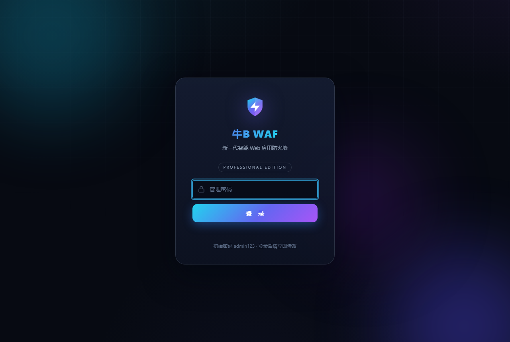
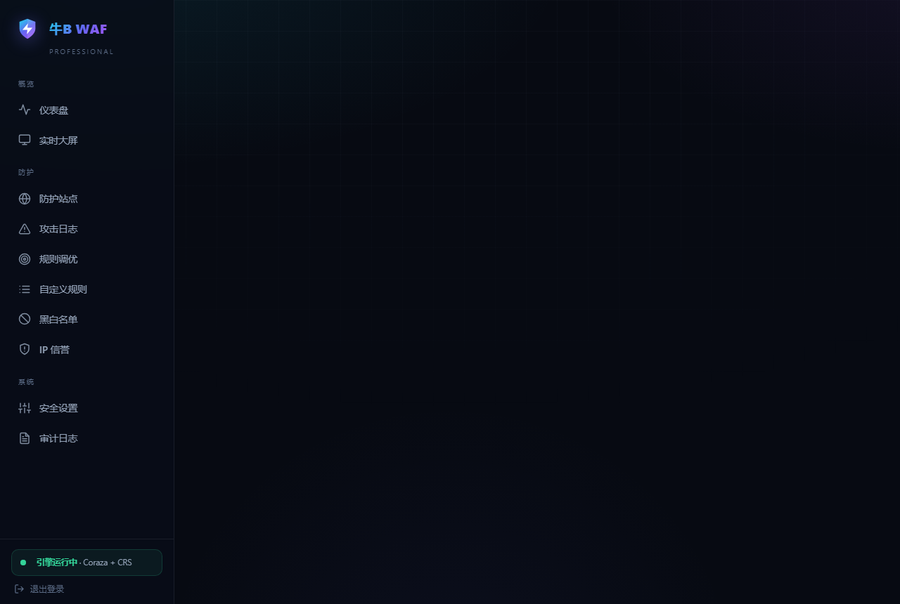
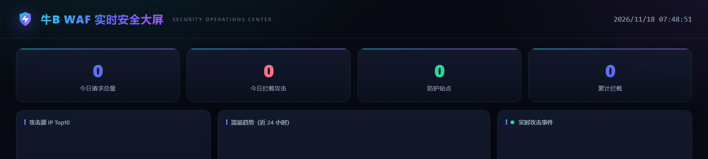

<p align="center">
  <picture>
    <source media="(prefers-color-scheme: dark)" srcset="brand/logo-dark.png">
    
  </picture>
</p>

<p align="center">
  <b>牛B WAF (NiuBWAF)</b> · 新一代智能 Web 应用防火墙<br>
  从零自研 · Go 语言 · Coraza v3 + OWASP CRS4 · 单二进制零依赖部署
</p>

<p align="center">
  
  
  
  
</p>

## 简介

牛B WAF 是一款**从零自研的生产级 Web 应用防火墙**，以反向代理模式部署在业务站点之前，对 HTTP/HTTPS 流量做全生命周期防护：

- **请求检测**：内嵌 OWASP CRS4 规则集 + 自研语义分析引擎（SQLi / XSS / RCE / 命令注入 / 扫描器特征）
- **CC 防护**：限流 + JS 人机验证挑战（混淆算法，无明文逻辑）
- **IP 治理**：黑白名单、IP 信誉库（攻击自动累积封禁、宽限与赦免）、GeoIP 归属地
- **响应防护**：响应体信息泄露检测（SQL 报错、敏感路径回显等）
- **运营能力**：自定义规则引擎、告警通知、攻击日志检索与流式 CSV 导出、实时安全大屏、Prometheus `/metrics`
- **多站点**：SNI 证书路由、多上游负载均衡与健康检查、故障自动切换
- **工程特性**：纯 Go SQLite（CGO_ENABLED=0）、单一静态二进制、systemd / Docker 双部署、热升级、SQLite 自动备份、强制改密门禁、管理台 HTTPS-only

## 快速开始

```bash
# 编译（Linux 目标）
CGO_ENABLED=0 GOOS=linux GOARCH=amd64 go build -trimpath -ldflags="-s -w" -o niubwaf .

# 运行（8080 HTTP 代理 / 8443 HTTPS 代理 / 9443 管理台）
./niubwaf -port 8080 -admin-port 9443
```

首次打开 `https://<host>:9443` 使用初始密码登录后会被强制修改密码。完整部署（systemd、证书、备份、升级回滚、生产配置清单）见 [DEPLOY.md](DEPLOY.md)。

> GeoIP 库 `geoip.mmdb` 因 MaxMind 许可限制不随仓库分发，需自行获取后放入 `data/` 目录；缺失时归属地功能自动降级，不影响其他能力。

## 界面预览

| 登录页 | 管理控制台 | 实时安全大屏 |
| --- | --- | --- |
|  |  |  |

## 项目结构

```
internal/
  engine/   Coraza v3 封装：CRS4 装载、语义引擎、送检上限与截断豁免
  proxy/    反向代理：站点路由、SNI、负载均衡、CC/人机验证、响应检测
  api/      管理 API：站点/日志/规则/信誉/告警/设置/备份
  store/    纯 Go SQLite 持久层（WAL、连接池、自动备份）
  metrics/  Prometheus 指标
  web/      内嵌管理控制台（暗色玻璃拟态 UI + 实时大屏）
brand/      品牌资产（闪电盾徽标 SVG/PNG、明暗横版）
docs/       截图等文档资源
```

## 测试

```bash
go test ./...          # 单元与集成测试
```

仓库 `test/` 目录提供压测/回归用的上游夹具脚本。

## 许可

Apache-2.0。内嵌的 Coraza v3 与 OWASP CRS 规则集同为 Apache-2.0 许可。

本项目为独立从零实现，不基于任何现有 WAF 产品代码。
